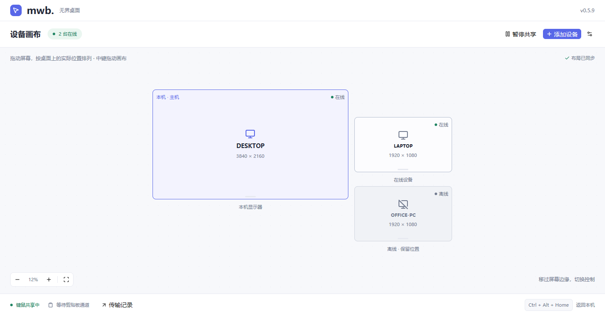
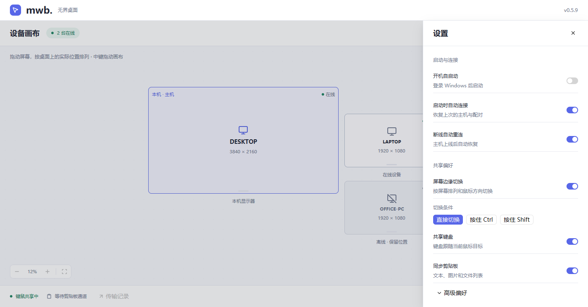

<div align="center">

<h1>MWB Rust</h1>

<p>一套键鼠，自由连接多台 Windows 电脑。</p>

<p>
  
  
  
  
</p>

<p>
  <a href="https://github.com/o0olele/mwb-rs/releases">下载</a> ·
  <a href="#快速开始">快速开始</a> ·
  <a href="docs/usage.md">使用文档</a> ·
  <a href="CHANGELOG.md">更新日志</a>
</p>

</div>

MWB Rust 是基于 Rust 与 GPUI Kit 的 Windows 多设备键鼠共享工具。将鼠标移过屏幕边缘，即可切换到另一台电脑，继续输入、复制和粘贴。

## 界面预览

<p align="center">
  
</p>

<p align="center"><sub>当前开发版的实际界面渲染，设备名称与布局使用演示数据。</sub></p>

<details>
<summary>查看首次配置与共享设置</summary>

<p align="center">
  
  
</p>

</details>

## 功能

- **多设备键鼠共享**：一个工作组最多 16 台设备，支持从屏幕边缘连续切换。
- **自由屏幕布局**：按实际分辨率显示多屏，拖动排列、缩放与平移，同步保存布局。
- **跨设备复制粘贴**：自动同步文本、图片和文件列表，支持资源管理器 `Ctrl+C` / `Ctrl+V` 粘贴文件。
- **文件传输**：按需下载、独立数据通道、可调限速与 SHA-256 校验，不设置文件大小上限。
- **自动恢复连接**：加密保存配对信息，支持自动重连和可选的登录自启动。
- **原生桌面界面**：首次配置与日常画布分离，设置和传输记录按需展开。

## 快速开始

**运行环境：Windows 10 / 11 x64，同一局域网内的每台电脑均需运行 MWB Rust。** 安装包与版本说明见 [Releases](https://github.com/o0olele/mwb-rs/releases)，安装、更新与卸载方式见 [安装指南](docs/install.md)。

1. 在一台持续在线的电脑选择 **作为主机 → 创建主机**。
2. 打开顶部的 **添加设备**，复制主机地址、端口与配对密钥。
3. 在其他电脑选择 **连接主机**，填写上述信息，点击 **连接并记住**。
4. 在画布上拖动屏幕，使其与桌面上的实际位置一致，点击 **保存布局**。
5. 将鼠标移过屏幕边缘，开始共享键鼠。下次打开会自动恢复已保存的连接。

**紧急返回：`Ctrl + Alt + Home`**，立即暂停共享并回到本机。

默认控制端口为 TCP `24810`；剪贴板和文件还使用协商的动态 TCP 端口。首次联网时允许专用网络访问。主机需持续运行；本项目使用独立协议，不兼容原版 Mouse without Borders / PowerToys。

## 文档

| 文档 | 内容 |
| --- | --- |
| [使用指南](docs/usage.md) | 设备连接、布局、剪贴板、文件传输与设置 |
| [安装与更新](docs/install.md) | MSI 安装、便携使用、登录自启动与卸载 |
| [锁屏输入服务](docs/input-service.md) | 管理员窗口、锁屏控制的部署与使用范围 |
| [开发指南](docs/development.md) | 构建环境、验证命令与安装包打包 |
| [更新日志](CHANGELOG.md) | 各版本变更与兼容性说明 |

目前暂不支持自动发现、文件夹传输、断点续传、托盘运行或首次登录前恢复连接。详细限制见 [使用指南](docs/usage.md#当前边界)。

## 从源码运行

需要 Rust 1.95+ MSVC、Visual Studio C++ Build Tools、Windows SDK 与 CMake。仓库已固定 Rust 工具链版本。

```powershell
git clone https://github.com/o0olele/mwb-rs.git
cd mwb-rs
cargo run --locked
```

构建发布版使用 `cargo build --release --locked`，输出位于 `target/release/`。测试与打包说明见 [开发指南](docs/development.md)。

## 反馈与贡献

欢迎通过 [Issues](https://github.com/o0olele/mwb-rs/issues) 反馈问题，附上应用版本、Windows 版本、复现步骤和相关连接记录。提交 Pull Request 前，请完成 [开发指南中的检查](docs/development.md#构建与检查)。
