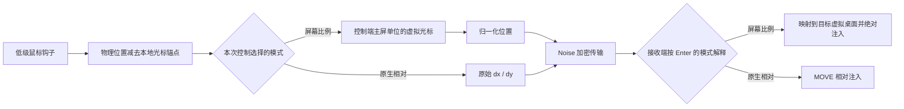

# 鼠标输入设计

v0.2.0 按 Microsoft Garage Mouse without Borders 2.2.1.0327 的核心坐标与切换逻辑独立实现。范围是当前双机、左右布局的输入链；未扩展为原版四机矩阵、文件传输或 Windows 服务。原版样本与反编译材料保留在本地忽略目录，仓库只包含 Rust 实现和设计说明。

## 坐标流



捕获仍基于 WH_MOUSE_LL 的物理光标坐标，不能称为读取原始 HID 计数。钩子消息线程提高到 Highest 优先级，回调通过非阻塞队列发送消息。采集位置和显示尺寸使用物理坐标，读取桌面指标时临时进入 Per-monitor V2 DPI 上下文。

## 屏幕比例模式

原版的 `MoveMouseRelatively` 设置缺省为 false。重写版的 `relative_mouse=false` 走屏幕比例路径，由控制端维护虚拟光标。x 轴每个 delta 对协议位置的贡献为：

```text
normalized_delta_x = dx * 65535 / source_primary_width
```

y 轴使用主屏高度。实际用 i64 定点累计后再除，避免每条小位移单独取整。接收端按目标虚拟桌面大小还原位置，不再把 delta 加到远端物理像素位置。源主屏与目标整个桌面的含义分别保留。

原版用手工变换加 ABSOLUTE 处理多屏；重写版在已经还原目标物理位置后，以 ABSOLUTE | VIRTUALDESK 定位到像素中心。协议比例和 Win32 归一化区间分开计算，既保留比例语义，也保留 v0.1.2 的小位移精度修复。

进入时两端使用相同的归一化边缘内缩位置，保留 y 比例；控制端虚拟位置携带小数部分，首条 delta 为零时远端不跳动。手动控制和屏幕边缘控制走相同的初始化。

## 原生相对模式

`relative_mouse=true` 时，消息携带 dx/dy，接收端只使用 MOUSEEVENTF_MOVE 注入。它没有累计成绝对位置，也没有 ABSOLUTE/VIRTUALDESK 标志。原版协议用 ±100000 标记分量；重写版用不同消息类型表达同一个区分，不需要魔数。

v0.2.1 起所有鼠标与键盘输入统一使用标准 `SendInput`。v0.2.0 曾使用原版的私有 `InjectMouseInput` 导出，但本机对比发现该导出存在时，零位移标准 MOUSEINPUT 调用仍返回 0 / 错误码 87；同一事件通过 SendInput 成功。因此不再依赖该私有入口，屏幕比例和原生相对坐标语义不受影响。注入保留自定义 dwExtraInfo 标记及 injected 事件过滤。

相对注入结果由 Windows 处理；系统指针速度与阈值可能影响最终距离，见 [MOUSEINPUT](https://learn.microsoft.com/en-us/windows/win32/api/winuser/ns-winuser-mouseinput)。接收端的会话循环在异步事件处理后观察真实光标，只用于边缘判断，不据此构建下一次输入的位置。

## 控制权切换

连接认证与设备握手完成后，两端自动安装钩子并启用共享。暂停和紧急返回继续有效。Enter 携带进入方向、归一化 x/y 落点和本次控制的模式，由控制端选择；接收端的偏好不覆盖它。

屏幕比例路径用虚拟光标跨过入口边缘判断返回；相对路径用实际光标到达入口边缘判断返回。其他边缘只钳制，不会返回到没有邻居的方向。Return 携带当前高度，控制端在靠近对方的本地边缘恢复光标，并释放远端按键。切入和返回包含 100 ms 保护。

v0.2.2 增加可选角落避让，默认关闭。开启后，以本机整个虚拟桌面为边界，左右边缘顶部/底部各 100 物理像素内不触发切入或返回；两种移动模式均适用。它不阻止手动控制、物理键鼠接管或紧急返回。暂未逐显示器枚举错列布局中的角落，不能视为原版 sensitivePoints 的完整替代。

修改鼠标模式先返回本机，下一次 Enter 重新冻结模式与虚拟光标起点。输入事件的模式不符、坐标或位移越界会使连接失败并释放按键，避免以错误单位注入。旧协议在 Hello 阶段被拒绝，输入钩子不会因此启动。Noise 加密格式保持原有实现。

操作系统注入失败与协议校验错误使用不同错误类型。`SendInput` 未接受预期事件时，立即记录返回值与 Win32 错误码，释放已按下的按键、退回本机并暂停共享；TCP 连接和心跳继续工作，用户可恢复共享。不会把所有拒绝都解释为权限不匹配，也不会忽略异常协议消息。返回通知中的光标停放是尽力操作，失败不再互相触发失败通知循环。

v0.2.2 将暂停意图与当前连接的共享可用状态分开。网络重连仍会释放旧会话的按键并重新握手；原本暂停或发生注入故障的会话保持暂停，直到手动恢复。正常共享遇到网络中断则在连接成功后恢复待命。剪贴板系统写入错误单独记录，不再终止键鼠会话。

## 验证边界

纯计算测试覆盖比例、首条移动、不同屏幕尺寸和原点、单像素累计、分批一致、原生相对位移、边缘方向与异常输入。TCP 回环测试通过真实加密消息和坐标计算验证 1920→3840 的双轴位移，以及绝对返回和相对模式的异步返回通知。

常规测试不安装全局钩子，不调用真实输入注入，也不改变桌面光标。另有默认忽略的交互式检查，仅注入一次零位移鼠标事件，用于核对当前 Windows 上的真实 API 是否接受标准输入。最终手感需要两台实体电脑分别验证比例/相对模式、正反方向、不同缩放和多屏布局。原版服务、锁屏及 UAC 桌面能力仍不在本版范围内。
